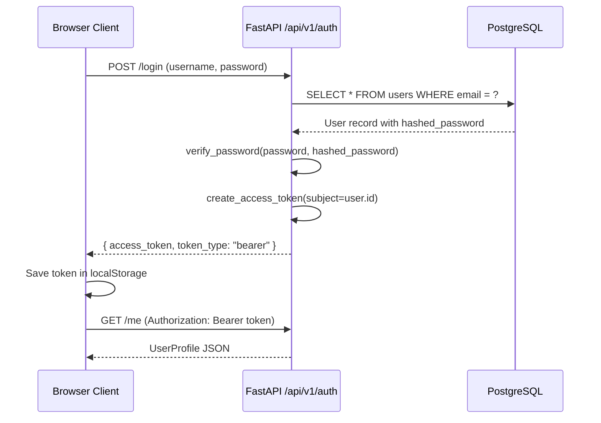
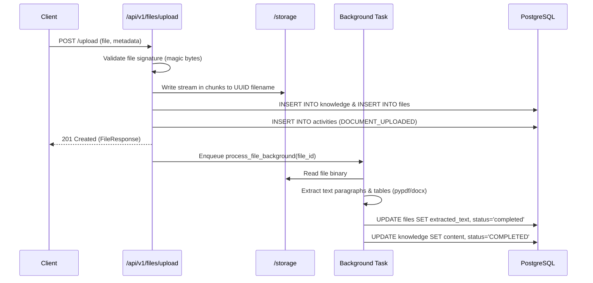
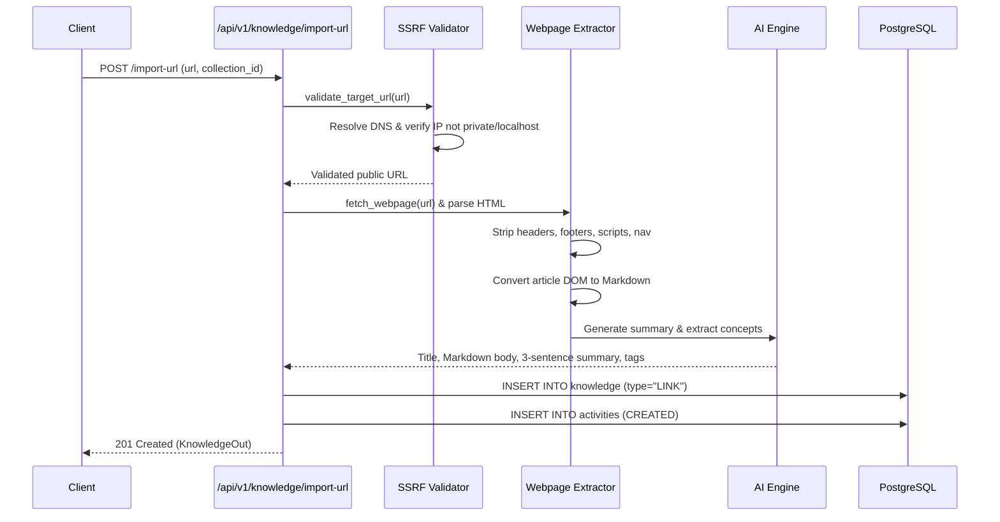
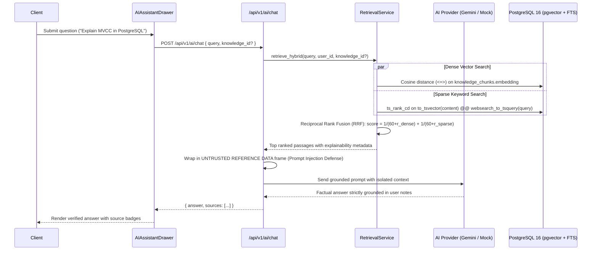

# Second Brain — System Architecture & Workflow Specifications

This document provides a technical walkthrough of the **Second Brain** system architecture, data models, state management, and lifecycle workflows.

---

## 1. System Components

The application is structured into three primary tiers:

```mermaid
flowchart LR
    subgraph Presentation_Layer [Presentation Layer: Next.js 16 / React 19]
        AppShell[AppShell / Layout]
        Context[KnowledgeContext & AuthContext]
        Views[Dashboard, Library, Detail, Collections, Tags, Settings]
        Drawers[AIAssistantDrawer, CommandPalette, AddKnowledgeModal]
    end

    subgraph Service_Layer [Service & Business Logic: FastAPI]
        Router[API v1 Routers]
        AuthService[Auth & JWT Verification]
        DocProcessor[Document Processor / pypdf & docx]
        WebClipper[Web Extractor & SSRF Guard]
        SearchService[Search Relevance Engine]
        AIOrchestrator[AI Provider: Mock / Gemini]
        ActivityLogger[Activity Tracking Engine]
    end

    subgraph Persistence_Layer [Persistence & Storage]
        PostgresDB[(PostgreSQL 16 Relational Database)]
        LocalStorage[(Local File Storage: /storage)]
    end

    Presentation_Layer <-- JSON REST / Bearer JWT --> Service_Layer
    Service_Layer <--> PostgresDB
    Service_Layer <--> LocalStorage
```

---

## 2. Frontend / Backend Communication Pipeline

1. **State Hydration**: On authentication, `KnowledgeContext` calls `refreshAllData()`. It dispatches parallel async requests via `apiClient`:
   - `GET /api/v1/knowledge`: Ingests user-scoped notes with pagination and active filters.
   - `GET /api/v1/collections`: Ingests user collections with live document counts.
   - `GET /api/v1/tags`: Ingests user tags.
   - `GET /api/v1/dashboard/stats`: Ingests real-time aggregated metrics and recent items.
   - `GET /api/v1/activities`: Ingests user audit timeline events.
2. **Optimistic & Synchronous Updates**: After any mutating CRUD operation (create note, toggle favorite, edit collection), the client immediately updates the local state and dispatches background synchronizations.
3. **HTTP Interceptor**: `apiClient` manages automatic injection of `Authorization: Bearer <token>`, content-type negotiation, and standardized error transformation (`ApiClientError`).

---

## 3. Database Schema & Relationships

### Core Relational Models:
1. **User (`users`)**:
   - Primary key: UUID string.
   - Fields: `email` (unique, indexed), `hashed_password`, `name`, `role`, `storage_used_bytes`, `storage_limit_bytes`.
   - Relationships: One-to-many with `Knowledge`, `Collections`, `Tags`, `Files`, and `Activities` (all configured with `cascade="all, delete-orphan"`).
2. **Knowledge (`knowledge`)**:
   - Primary key: UUID string.
   - Foreign keys: `user_id` (ondelete="CASCADE"), `collection_id` (ondelete="SET NULL").
   - Fields: `title`, `type` (NOTE, LINK, PDF, DOCUMENT), `summary`, `content`, `original_url`, `is_favorite`, `is_archived`, `created_at`, `updated_at`, `last_accessed_at`.
   - Relationships: Many-to-many with `Tag` via junction table `knowledge_tags`. One-to-many with `File`.
3. **File (`files`)**:
   - Primary key: UUID string.
   - Foreign keys: `user_id` (ondelete="CASCADE"), `knowledge_id` (ondelete="SET NULL").
   - Fields: `original_filename`, `stored_filename`, `mime_type`, `size_bytes`, `processing_status` (uploaded, processing, completed, failed), `extracted_text`.
4. **Activity (`activities`)**:
   - Primary key: UUID string.
   - Foreign keys: `user_id` (ondelete="CASCADE").
   - Fields: `action` (CREATED, UPDATED, DELETED, FAVORITED, DOCUMENT_UPLOADED, etc.), `knowledge_id`, `knowledge_title`, `type`, `timestamp`.

---

## 4. End-to-End Workflows

### A. Authentication & Session Flow

### B. Document Upload & Processing Workflow

### C. Web Clipper Extraction Workflow

### D. AI Grounded Chat & Context Isolation

---

## 5. Second Brain AI 2.0 — Enterprise Hybrid RAG Architecture

Second Brain AI 2.0 upgrades the knowledge engine from basic full-document stuffing to an enterprise Retrieval-Augmented Generation (RAG) architecture powered by pgvector and PostgreSQL Full-Text Search.

### A. Document Chunking & Ingestion Pipeline
- **Boundary-Aware Chunking**: Documents are split into semantic chunks (default 500 characters, 100 character overlap) honoring paragraph, sentence, markdown heading, and page boundaries.
- **Idempotent Ingestion**: Chunks compute SHA-256 content hashes (`content_hash`) to avoid redundant re-embedding.
- **Dual Persistent Models**:
  - `knowledge`: Stores document-level metadata, summary, total chunks, and indexing status (`UNINDEXED`, `INDEXED`, `FAILED`).
  - `knowledge_chunks`: Stores isolated text passages, 768-dimensional vector embeddings, source metadata (page numbers, section headings), and content hashes.

### B. Embedding Subsystem & Google Gemini Provider
- **Model**: `gemini-embedding-001` (768 dimensions).
- **Asymmetric Task Types**:
  - Document chunking: `taskType: "RETRIEVAL_DOCUMENT"`.
  - User query search: `taskType: "RETRIEVAL_QUERY"`.
- **Dimensionality Enforcement**: Output dimensionality explicitly locked to 768 floats with finite numeric validation.
- **Zero Silent Fallback**: In production, API errors (401/403 auth, 404 not found, 429 rate limit, timeout) raise typed exceptions (`EmbeddingAuthError`, `EmbeddingRateLimitError`) rather than silently substituting random mock vectors.
- **Model Space Isolation**: Queries filter by `embedding_model == active_model`, preventing vector space contamination between real and mock vectors.

### C. Hybrid Retrieval with Reciprocal Rank Fusion (RRF)
To achieve state-of-the-art recall and precision across domain-specific jargon, keywords, and semantic concepts:
1. **Dense Vector Retrieval**:
   - Queries `knowledge_chunks` using PostgreSQL pgvector cosine distance operator `<=>`.
   - Cosine similarity: $Score_{dense} = 1.0 - CosineDistance(q, d)$.
   - Filtered by `user_id` and optional `knowledge_id` (single-document context mode).
2. **Sparse Keyword Retrieval**:
   - Uses PostgreSQL Full-Text Search via `to_tsvector('english', content)` and `websearch_to_tsquery('english', query)`.
   - Accelerated by GIN index `ix_knowledge_chunks_fts`.
   - Ranked using Cover Density ranking (`ts_rank_cd`).
   - Graceful tokenized fallback when terms contain non-stemmed identifiers.
3. **Reciprocal Rank Fusion (RRF)**:
   - Rank fusion standard formula with $k = 60$:
     $$RRF(d) = \sum_{m \in \{dense, sparse\}} \frac{w_m}{k + rank_m(d)}$$
   - Chunks retrieved by both algorithms receive top precedence with transparent explainability tags (`dense_rank`, `dense_score`, `sparse_rank`, `sparse_score`, `rrf_score`).

### D. Security Boundaries & Prompt Injection Defense
- **Untrusted Reference Data Framing**: Retrieved chunk contents are wrapped in explicit boundary markers:
  `=== RETRIEVED KNOWLEDGE (UNTRUSTED REFERENCE DATA) ===`
- **System Instruction Hardening**: LLMs are instructed to treat retrieved content strictly as passive reference facts. Any embedded directives attempting to override instructions, roleplay, or exfiltrate prompts are neutralized.
- **Tenant Isolation**: All vector and keyword queries enforce `user_id == current_user.id` at the database level.
- **Context Isolation**: Single-document mode strictly confines chunk retrieval to `knowledge_id == target_id`, eliminating context bleeding between unrelated documents.

