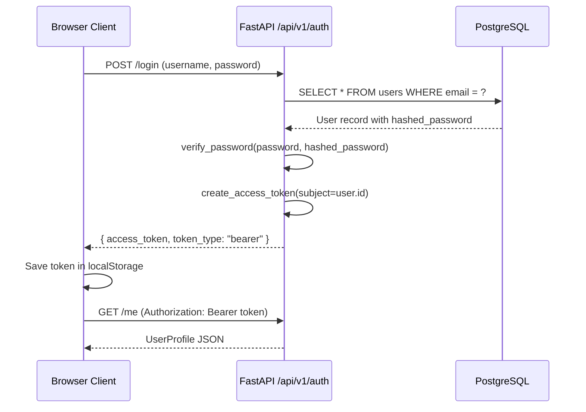
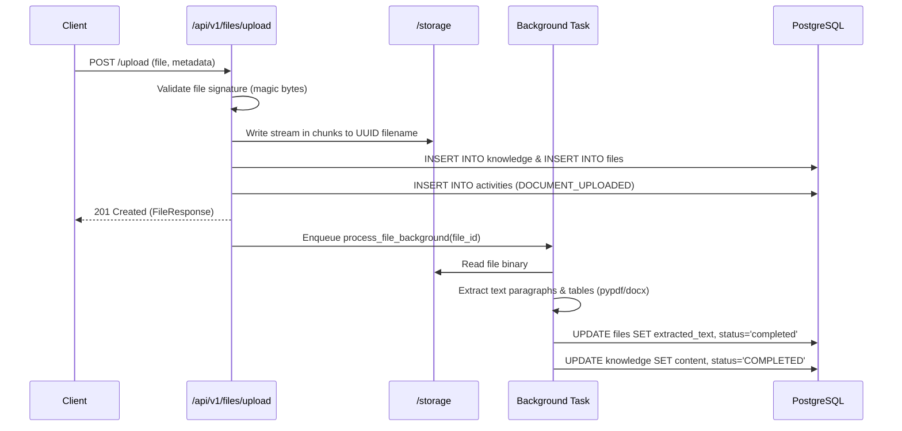
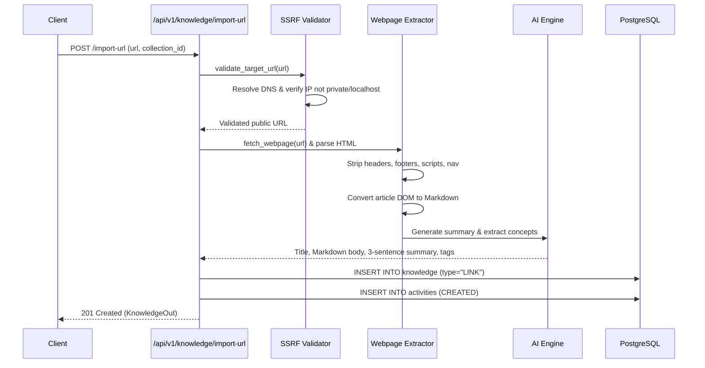
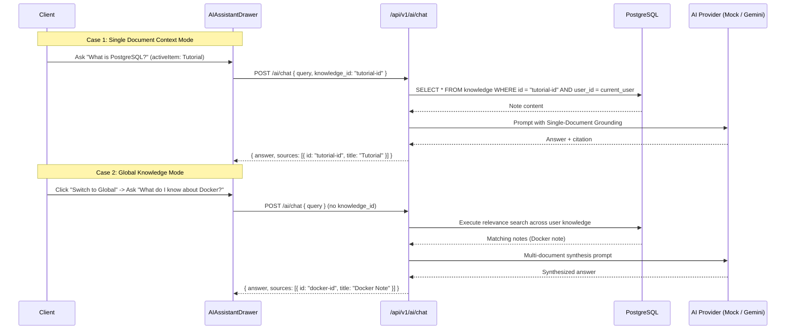

# Second Brain — System Architecture & Workflow Specifications

This document provides a technical walkthrough of the **Second Brain** system architecture, data models, state management, and lifecycle workflows.

---

## 1. System Components

The application is structured into three primary tiers:

```mermaid
flowchart LR
    subgraph Presentation_Layer [Presentation Layer: Next.js 16 / React 19]
        AppShell[AppShell / Layout]
        Context[KnowledgeContext & AuthContext]
        Views[Dashboard, Library, Detail, Collections, Tags, Settings]
        Drawers[AIAssistantDrawer, CommandPalette, AddKnowledgeModal]
    end

    subgraph Service_Layer [Service & Business Logic: FastAPI]
        Router[API v1 Routers]
        AuthService[Auth & JWT Verification]
        DocProcessor[Document Processor / pypdf & docx]
        WebClipper[Web Extractor & SSRF Guard]
        SearchService[Search Relevance Engine]
        AIOrchestrator[AI Provider: Mock / Gemini]
        ActivityLogger[Activity Tracking Engine]
    end

    subgraph Persistence_Layer [Persistence & Storage]
        PostgresDB[(PostgreSQL 16 Relational Database)]
        LocalStorage[(Local File Storage: /storage)]
    end

    Presentation_Layer <-- JSON REST / Bearer JWT --> Service_Layer
    Service_Layer <--> PostgresDB
    Service_Layer <--> LocalStorage
```

---

## 2. Frontend / Backend Communication Pipeline

1. **State Hydration**: On authentication, `KnowledgeContext` calls `refreshAllData()`. It dispatches parallel async requests via `apiClient`:
   - `GET /api/v1/knowledge`: Ingests user-scoped notes with pagination and active filters.
   - `GET /api/v1/collections`: Ingests user collections with live document counts.
   - `GET /api/v1/tags`: Ingests user tags.
   - `GET /api/v1/dashboard/stats`: Ingests real-time aggregated metrics and recent items.
   - `GET /api/v1/activities`: Ingests user audit timeline events.
2. **Optimistic & Synchronous Updates**: After any mutating CRUD operation (create note, toggle favorite, edit collection), the client immediately updates the local state and dispatches background synchronizations.
3. **HTTP Interceptor**: `apiClient` manages automatic injection of `Authorization: Bearer <token>`, content-type negotiation, and standardized error transformation (`ApiClientError`).

---

## 3. Database Schema & Relationships

### Core Relational Models:
1. **User (`users`)**:
   - Primary key: UUID string.
   - Fields: `email` (unique, indexed), `hashed_password`, `name`, `role`, `storage_used_bytes`, `storage_limit_bytes`.
   - Relationships: One-to-many with `Knowledge`, `Collections`, `Tags`, `Files`, and `Activities` (all configured with `cascade="all, delete-orphan"`).
2. **Knowledge (`knowledge`)**:
   - Primary key: UUID string.
   - Foreign keys: `user_id` (ondelete="CASCADE"), `collection_id` (ondelete="SET NULL").
   - Fields: `title`, `type` (NOTE, LINK, PDF, DOCUMENT), `summary`, `content`, `original_url`, `is_favorite`, `is_archived`, `created_at`, `updated_at`, `last_accessed_at`.
   - Relationships: Many-to-many with `Tag` via junction table `knowledge_tags`. One-to-many with `File`.
3. **File (`files`)**:
   - Primary key: UUID string.
   - Foreign keys: `user_id` (ondelete="CASCADE"), `knowledge_id` (ondelete="SET NULL").
   - Fields: `original_filename`, `stored_filename`, `mime_type`, `size_bytes`, `processing_status` (uploaded, processing, completed, failed), `extracted_text`.
4. **Activity (`activities`)**:
   - Primary key: UUID string.
   - Foreign keys: `user_id` (ondelete="CASCADE").
   - Fields: `action` (CREATED, UPDATED, DELETED, FAVORITED, DOCUMENT_UPLOADED, etc.), `knowledge_id`, `knowledge_title`, `type`, `timestamp`.

---

## 4. End-to-End Workflows

### A. Authentication & Session Flow

### B. Document Upload & Processing Workflow

### C. Web Clipper Extraction Workflow

### D. AI Grounded Chat & Context Isolation

